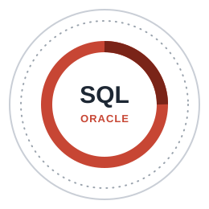
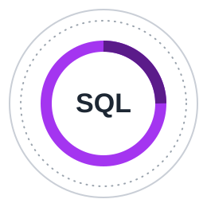
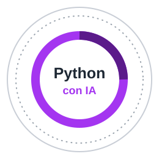
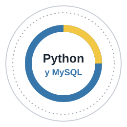

<!-- ====== BANNER ====== -->
<p align="center">
  
</p>

<!-- ====== TYPING ====== -->
<p align="center">
  <a href="https://github.com/sebassisamiami-sketch">
    
  </a>
</p>

<p align="center">
  
  
  
  <a href="https://skillshop.credential.net/6dc12d1f-290f-49a6-9bfa-4422e884d591"></a>
  
  
</p>

---

## 👨‍💻 Sobre mí

```js
const sebastian = {
  nombre:      "Kevin Sebastian Siabato Salgado",
  ubicacion:   "Bogotá, Colombia 🇨🇴",
  formacion:   ["Tecnólogo en Sistemas", "Ingeniería de Software (en curso) — Politécnico Grancolombiano"],
  experiencia: "2 años como Analista de Procesos en Corus Systems",
  fuerte_en:   ["SQL", "Calidad de datos", "Cumplimiento normativo (UGPP)", "Automatización con IA"],
  creando:     ["Videojuegos en Unity y Roblox", "Sitios web para negocios", "Herramientas con IA"],
  certificados: ["Google Analytics (Google, 2026)", "Oracle SQL: Databases for Developers (Oracle, 2026)"],
  idiomas:     { español: "nativo", ingles: "B1+" },
  busco:       "Mi próximo reto como desarrollador o analista de datos 🚀",
};
```

- 📊 Pasé **2 años** asegurando la **calidad de datos** y el **cumplimiento normativo (UGPP)** con SQL en Corus Systems.
- 🏅 Estoy **certificado en Google Analytics 4** por Google y completé **Databases for Developers** de **Oracle** con 98% (2026).
- 🎓 Estoy homologando mis estudios hacia **Ingeniería de Software** en el Politécnico Grancolombiano.
- 🎮 En mis ratos libres construyo **videojuegos**: un simulador de herrería para **Steam** (Unity / C#) y juegos en **Roblox** (Luau).
- 🤖 Me apasiona usar **inteligencia artificial** para automatizar tareas y crear herramientas útiles.
- 💬 Pregúntame sobre **SQL, automatización, desarrollo web o diseño de juegos**.

---

## 🏅 Certificaciones

<table align="center">
  <tr>
    <td align="center" width="180">
      <a href="https://skillshop.credential.net/6dc12d1f-290f-49a6-9bfa-4422e884d591"></a><br/>
      <b>Google Analytics</b><br/>
      <sub>Google Skillshop · 2026</sub><br/>
      <sub><a href="https://skillshop.credential.net/6dc12d1f-290f-49a6-9bfa-4422e884d591">Ver credencial</a></sub>
    </td>
    <td align="center" width="180">
      <br/>
      <b>Oracle SQL</b><br/>
      <sub>Oracle Dev Gym · 2026 · 98%</sub>
    </td>
    <td align="center" width="180">
      <!-- Enlace de verificación pendiente (ude.my/UC-...) -->
      <br/>
      <b>SQL</b><br/>
      <sub>Udemy · 2026</sub>
    </td>
    <td align="center" width="180">
      <!-- Enlace de verificación pendiente (ude.my/UC-...) -->
      <br/>
      <b>Python con IA</b><br/>
      <sub>Udemy · 2026</sub>
    </td>
    <td align="center" width="180">
      <br/>
      <b>Python y MySQL</b><br/>
      <sub>Certificación técnica · 2026</sub>
    </td>
  </tr>
</table>

---

## 🛠️ Tecnologías y herramientas

<p align="center">
  
  <br/>
  
</p>

<p align="center">
  
  
  
  
  
  
</p>

---

## 🚀 Proyectos destacados

| Proyecto | Qué es | Tecnología |
|---|---|---|
| 🤖 **[asistente-ia-procesos](https://github.com/sebassisamiami-sketch/asistente-ia-procesos)** | Asistente de IA que responde dudas de procedimientos internos: busca el documento correcto y explica paso a paso | `Python` · `LangChain` · `ChromaDB` · `Docker` |
| 📒 **[Bitacora-IA-sena](https://github.com/sebassisamiami-sketch/Bitacora-IA-sena)** | Bitácora de aprendizaje con apoyo de IA (proyecto del SENA) | `JavaScript` |
| 🖱️ **[Tu Página a un Clic](https://tupaginaaunclic.com)** · [repo](https://github.com/sebassisamiami-sketch/Tu-Pagina-A-un-clic) | Página de mis servicios de diseño web y apps: simulador para armar tu página, galería de estilos y panel de clientes | `HTML` · `CSS` · `JS` · `Firebase` |

<p align="center"><a href="https://tupaginaaunclic.com"><b>🖱️ Ver Tu Página a un Clic en vivo →</b></a></p>

### 🔨 En construcción

| Proyecto | Qué es | Tecnología |
|---|---|---|
| 🖱️ **[Tu Página a un Clic](https://tupaginaaunclic.com)** | Página de mis servicios de diseño web y apps: simulador para armar tu página, galería de 30 estilos y panel de clientes | HTML · CSS · JS · Firebase |
| ⚒️ **Waterfall Forge** | Simulador incremental de herrería junto a una cascada, pensado para **Steam** | Unity · C# |
| ⏳ **Chrono-Heist: Paradox** | Juego de atracos con viajes en el tiempo, dividido en fases | Roblox · Luau |
| 🧊 **Rompe el Cubo** | Juego incremental: rompe un cubo gigante en un bosque nocturno | Roblox · Luau |
| 💈 **Stile Club Barbiere** | Sitio web responsive con reserva de citas para una barbería | HTML · CSS · JS |

---

## 📈 Estadísticas

<p align="center">
  
  
</p>

<p align="center">
  
</p>

<p align="center">
  
</p>

---

## 🐍 Mis contribuciones, devoradas

<p align="center">
  <picture>
    <source media="(prefers-color-scheme: dark)" srcset="https://raw.githubusercontent.com/sebassisamiami-sketch/sebassisamiami-sketch/output/github-snake-dark.svg" />
    <source media="(prefers-color-scheme: light)" srcset="https://raw.githubusercontent.com/sebassisamiami-sketch/sebassisamiami-sketch/output/github-snake.svg" />
    
  </picture>
</p>

---

## 🤝 Conectemos

<p align="center">
  <a href="https://github.com/sebassisamiami-sketch"></a>
  <a href="mailto:sebastian.sisatravel@gmail.com"></a>
  <a href="https://www.linkedin.com/in/devkevin-sebastian-siabato-salgado/"></a>
</p>

<p align="center">
  <i>"El código bien hecho, como los datos limpios, habla por sí solo."</i>
</p>

<!-- ====== FOOTER ====== -->
<p align="center">
  
</p>
